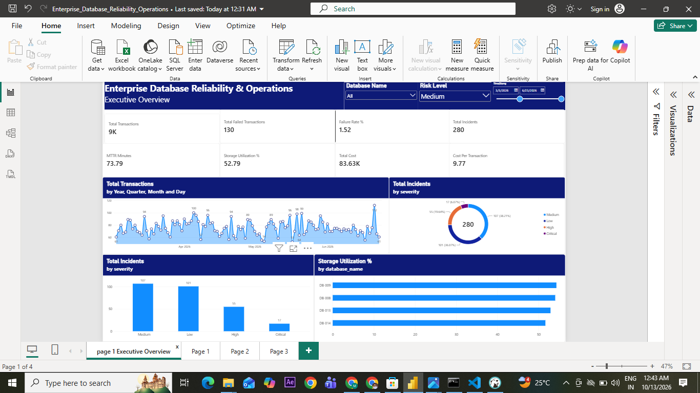
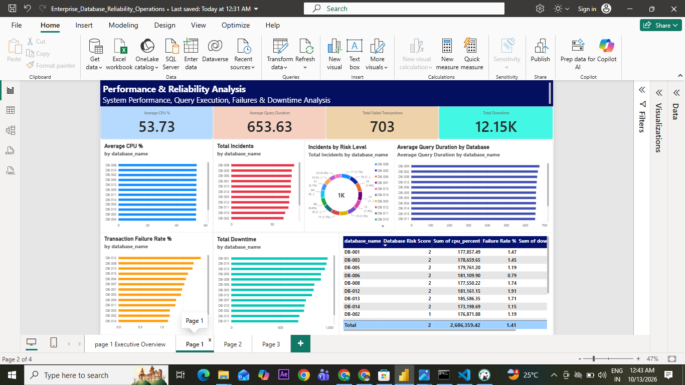
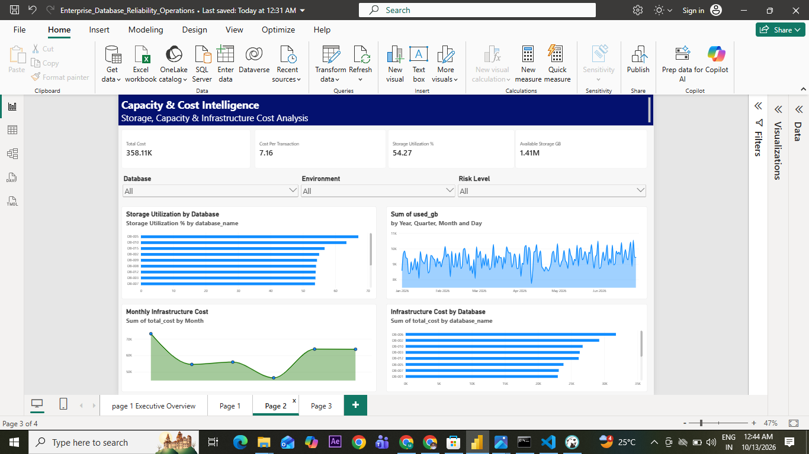
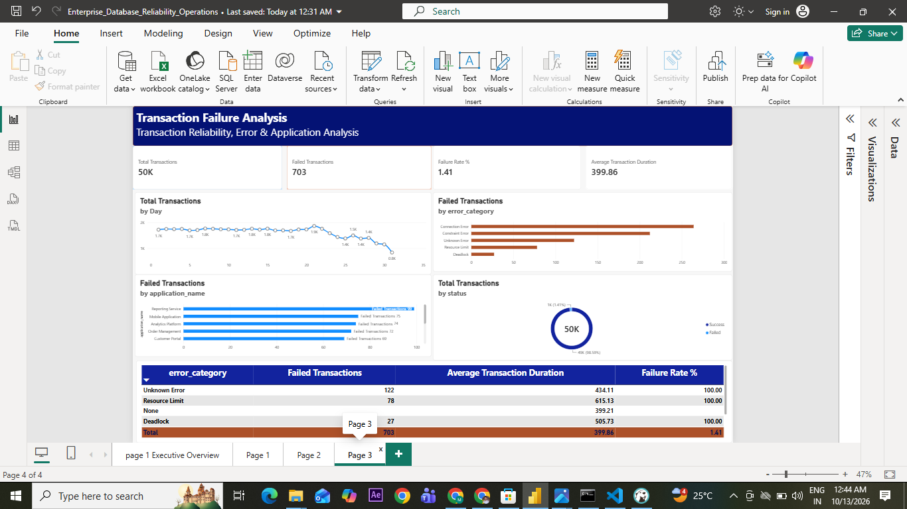

Yes 👍 You want the README to be **very easy for a beginner to understand**.

Here is a simpler version you can use.

# 📊 Project Overview — Beginner Version


# 🏆 Enterprise Database Reliability, Performance & Cost Intelligence Platform

----

----

----

----

## 📌 What is this project?

This is a **Data Analytics project** based on a real-world database monitoring scenario.

In this project, we collect database-related data and use:

- 🐍 Python
- 🐼 Pandas
- 🔢 NumPy
- 🐘 PostgreSQL
- 🗃️ SQL
- 📊 Power BI
- 🧮 DAX

to understand the health, performance, reliability, storage, and cost of databases.

---

## 🎯 Why did I create this project?

As a DBA, we monitor many things in databases.

For example:

- CPU usage
- Query performance
- Transaction failures
- Database incidents
- Downtime
- Storage usage
- Infrastructure cost

But raw data is difficult for managers to understand.

So, this project converts the raw database data into:

```text
Raw Data
   ↓
Python
   ↓
PostgreSQL
   ↓
SQL
   ↓
Power BI
   ↓
Charts & KPIs
   ↓
Business Insights


---

## 🏢 Simple Business Example

Imagine a company has many databases.

One database may have:

```text
CPU            → 85%
Query Time     → 2500 ms
Failed Txns    → 120
Incidents      → 50
Downtime       → 400 minutes
Storage        → 90%
Cost           → High
```

A manager may ask:

> ❓ Which database has problems?

> ❓ Why are transactions failing?

> ❓ Which database is using more storage?

> ❓ Which database costs more?

> ❓ Which database should we investigate first?

This project helps answer these questions.

---

# 🔄 How does the project work?

## Step 1 — Generate Data 🐍

Python is used to create realistic sample database monitoring data.

Example:

```text
CPU
Memory
Transactions
Queries
Incidents
Storage
Cost
```

---

## Step 2 — Store Data 🐘

The data is stored in **PostgreSQL**.

Example tables:

```text
dim_database
dim_application
fact_transactions
fact_incidents
fact_storage
fact_cost
fact_performance_metrics
fact_query_performance
```

---

## Step 3 — Analyze Data 🗃️

SQL is used to answer questions.

For example:

```sql
SELECT
    database_id,
    AVG(cpu_percent) AS average_cpu
FROM fact_performance_metrics
GROUP BY database_id;
```

This tells us:

> Which databases have higher average CPU usage?

---

## Step 4 — Create KPIs 📊

We calculate important numbers such as:

```text
Total Transactions
Failed Transactions
Failure Rate
Total Incidents
MTTR
Total Downtime
Storage Utilization
Total Cost
Cost Per Transaction
```

---

## Step 5 — Create Power BI Dashboard 📈

The PostgreSQL data is connected to Power BI.

Power BI is used to create:

- Cards
- Bar charts
- Line charts
- Donut charts
- Slicers
- Interactive reports

---

# 📊 Power BI Dashboard Pages

## 1️⃣ Executive Overview

This page gives the **overall picture**.

It shows:

```text
📊 Total Transactions
❌ Failed Transactions
⚠️ Failure Rate
🚨 Total Incidents
⏱️ MTTR
💾 Storage Utilization
💰 Total Cost
💵 Cost Per Transaction
```

### Simple question:

> **How healthy is the overall database environment?**

---

## 2️⃣ Performance & Reliability

This page focuses on database performance.

It shows:

```text
⚙️ Average CPU
⚡ Query Duration
❌ Failed Transactions
⏱️ Downtime
🚨 Incidents
```

### Simple question:

> **Which databases are having performance or reliability problems?**

---

## 3️⃣ Capacity & Cost Intelligence

This page focuses on storage and money.

It shows:

```text
💰 Total Cost
💵 Cost Per Transaction
💾 Storage Utilization
🗄️ Available Storage
📈 Storage Growth
```

### Simple question:

> **How much storage and money are we using?**

---

## 4️⃣ Transaction Failure Analysis

This page focuses on failed transactions.

It shows:

```text
📊 Total Transactions
❌ Failed Transactions
⚠️ Failure Rate
⏱️ Average Transaction Duration
```

It also analyzes:

```text
Error Categories
Applications
Transaction Status
Transaction Trends
```

### Simple question:

> **Why are transactions failing?**

---

# 🗄️ Main Database Tables

### Dimension Tables

These tables contain **basic/master information**.

```text
dim_database
dim_application
dim_sla
```

### Fact Tables

These tables contain **actual activity/data**.

```text
fact_performance_metrics
fact_query_performance
fact_transactions
fact_incidents
fact_storage
fact_cost
```

### Easy way to remember

```text
DIMENSION = Who / What

FACT = What happened
```

Example:

```text
dim_database
      ↓
Database information

fact_transactions
      ↓
Transaction activity
```

---

# 🧰 Tools Used

| Tool | Why I used it |
|---|---|
| 🐍 Python | Data generation and analysis |
| 🐼 Pandas | Data cleaning |
| 🔢 NumPy | Numerical calculations |
| 🐘 PostgreSQL | Store data |
| 🗃️ SQL | Analyze data |
| 📊 Power BI | Create dashboards |
| 🧮 DAX | Create Power BI calculations |

---

# 🔍 What can we learn from this project?

This project helps us understand:

### Performance

> Is the database running efficiently?

### Reliability

> Are transactions successful?

### Incidents

> Are production problems increasing?

### Storage

> Are databases running out of space?

### Cost

> Which databases are expensive?

### Business

> Which problems should we investigate first?

---

# 🔄 Complete Project Flow

```text
             🐍 Python
                 ↓
          Generate / Clean Data
                 ↓
          🐘 PostgreSQL
                 ↓
             🗃️ SQL
                 ↓
          Analyze Data
                 ↓
            📊 Power BI
                 ↓
             🧮 DAX
                 ↓
          📈 Dashboard
                 ↓
          💡 Business Insights
```

---

# 🎯 Project Goal

The main goal of this project is:

> **Convert database technical data into simple business information that helps people make better decisions.**

---

# 👨‍💻 Skills Demonstrated

```text
Python
Pandas
NumPy
SQL
PostgreSQL
Power BI
DAX
Data Cleaning
Data Analysis
Data Visualization
Database Performance Analysis
Transaction Analysis
Storage Analysis
Cost Analysis
```

---

# 🔐 Data Note

This project uses **synthetic/sample data**.

It does not contain:

- Company confidential data
- Customer information
- Production credentials
- Real production logs

The data is created for **learning and portfolio purposes**.

---

# 👨‍💻 Author

## Mamidi Ramesh

**Full-Stack Developer | Data Analytics Enthusiast | DBA Domain Experience**

📍 Hyderabad, Telangana, India

---

# ⭐ Final Summary

This project connects my **DBA knowledge** with **Data Analytics**.

```text
DBA Knowledge
      +
Python
      +
SQL
      +
PostgreSQL
      +
Power BI
      +
DAX
      ↓
Data Analytics Project
      ↓
Business Insights
```

### 🚀 From Database Operations to Data Analytics
```

This version is better for your GitHub because a **beginner or recruiter can understand the project quickly without reading complex technical details**.